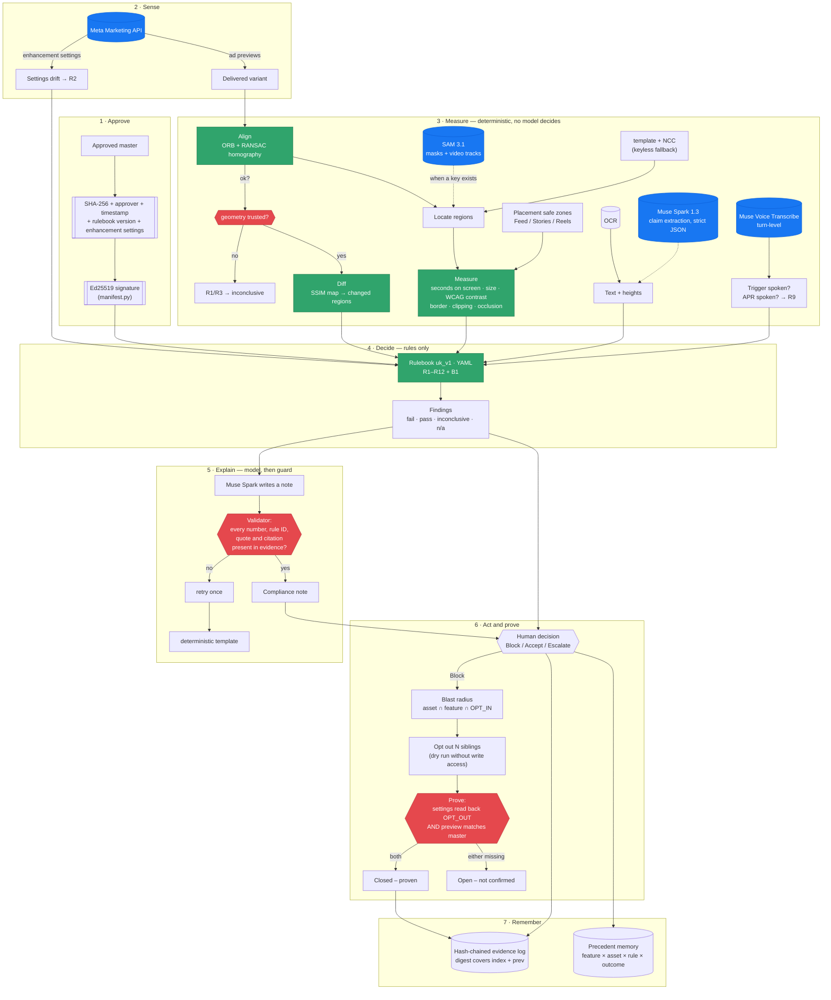

# Architecture

## The three load-bearing ideas

**Rules decide; the model explains.** Every verdict comes from a YAML rulebook
evaluated by deterministic code. Muse Spark extracts claims into a constrained
schema and writes prose — it never changes an outcome. The red boxes above are
guards, and each one can only make the system say *less*.

**"Could not measure" is a third outcome.** Every rule input may be `None`.
A rule with an unknown input returns `inconclusive`, never `pass` (which would
wave through a real breach) and never `fail` (which would accuse an advertiser
on a guess). There is a test asserting that an empty context produces zero
failures across all twelve rules.

**The baseline must be clean.** The approved masters are generated to satisfy
the rulebook — warning outside the placement's UI zone, own border, bold,
underlined, contrast ≥ 4.5:1, APR no less prominent than its trigger — and
tested for it. Measuring variants against a baseline that itself breached a rule
would make that rule's numbers meaningless. Building that test caught three real
breaches in our own masters.

## Where the Meta models sit

| Model | Job | Status without a key |
|---|---|---|
| **SAM 3.1** | Masks and video-tracks the warning box, APR, trigger, logo — frame by frame, stable IDs | Falls back to aligned template + normalised cross-correlation, **labelled as such in the UI** |
| **Muse Spark 1.3** | Claim and trigger extraction (strict JSON Schema); writes the compliance note | Falls back to OCR for text and a deterministic template for the note |
| **Muse Voice Transcribe** | Was the trigger spoken? Was the APR spoken? (R9) | No fallback exists — R9 reports `inconclusive` and those variants are **not evaluated**, never counted as passes |
| **Meta Marketing API** | Enhancement settings, previews, the opt-out write | R2 reports `inconclusive`; Act runs as a labelled dry run |

Every fallback is visible in the UI's provenance line. The point of the
region-IoU metric in the benchmark is to measure what SAM adds over the
fallback — a comparison that only means something because the fallback is a
real detector rather than a mock.
