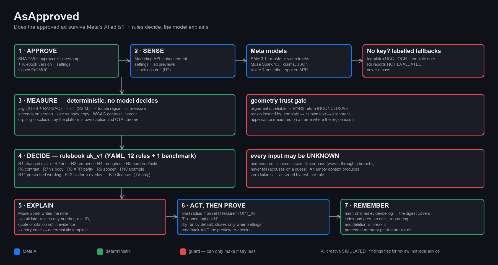

# AsApproved

**Meta's AI can move your FCA-mandated risk warning off screen. You won't be told. From 20 November, the liability is yours.**

AsApproved measures, frame by frame, whether the risk warning and representative
APR in a regulated firm's *approved* ad survive Meta's Advantage+ edits — then
plans the opt-out for every affected ad in one click, with a hash-chained
evidence record.



> **Status, plainly.** No Meta model has run yet. The Model API credit is claimed
> but not yet issued, so **every number below was produced by the keyless
> fallback path** — template + normalised cross-correlation for regions, OCR for
> text, a deterministic template for notes. The SAM 3.1 / Muse Spark / Voice
> Transcribe integration is written and unit-tested against the documented
> response formats, and has never been exercised against the live API.
> See [Where Meta's models sit](#where-metas-models-sit).

---

## Why

From **20 November 2026**, Meta's revised Ad Terms place "any and all risks" from
its AI creative features on the advertiser — including features Meta enables
itself. Advantage+ can generate up to 150 variations from an advertiser's
assets, Meta does not notify advertisers when it modifies creative, and previews
are examples rather than a record of what was served.

For a UK regulated advertiser a non-compliant financial promotion is not an
aesthetic problem. It is a regulatory one, and in the s.21 FSMA case a criminal
one. In 2024, firms amended or withdrew **19,766** promotions after FCA
intervention.

Three regimes, paraphrased — see [limits](#limits) on how settled these
citations are:

- **Consumer credit (CONC 3.5.7R)** — the representative APR must be given no
  less prominence than the trigger that required it.
- **Restricted mass market investments (COBS 4.12A)** — the prescribed warning
  must be prominent, clearly legible, in its own border, bold and underlined
  (.36R); nothing may reduce its visibility (.38R); and the wording is
  prescribed, in four variants by investment type (.11R).
- **Both (FG24/1, guidance)** — a firm owns a promotion for its whole life
  (4.14), and a prescribed warning must not be "obscured or truncated by a
  design feature of the social media platform" (1.5).

So regulated advertisers switch Advantage+ off. **AsApproved exists to let them
switch it on.**

## What it does

1. **Approve** a master — SHA-256, approver, timestamp, rulebook version and the
   enhancement settings in force, signed with Ed25519.
2. **Sense** — read each ad's Advantage+ settings and previews; flag drift
   against the signed manifest.
3. **Measure** — align each variant to its master, diff it, locate the regions
   that matter, and measure them: seconds on screen, size against the ad's own
   body copy, WCAG contrast, border, clipping, and occlusion by the platform's
   own caption and CTA chrome.
4. **Decide** — twelve FCA-derived rules in a versioned YAML rulebook produce
   findings, each carrying the measured value, the threshold, the citation and
   the evidence frame.
5. **Act once, fix many** — a lineage graph finds every sibling ad sharing the
   asset *and* enrolled in the enhancement: *fix once, opt out N*. Then Prove
   re-checks, and refuses to close until confirmed.
6. **Remember** — every decision appends to a hash-chained log where altering
   one byte names the exact record that broke.

## Three ideas that hold it together

**Rules decide; the model explains.** Every verdict comes from deterministic code
over a YAML rulebook. A model extracts claims into a constrained schema and
writes prose — it never changes an outcome. Before any generated sentence
reaches a human it passes a validator that rejects **any number, rule ID,
quotation or citation not present in the evidence**, retries once, then falls
back to a deterministic template. A fabricated audit trail is worse than none.

**"Could not measure" is a third outcome.** Every rule input may be unknown. An
unknown input returns `inconclusive` — never `pass`, which would wave through a
breach, and never `fail`, which would accuse an advertiser on a guess. A test
asserts an empty context produces **zero** failures across all twelve rules.

**The baseline must be clean.** The approved masters are generated to satisfy the
rulebook and tested against it. Writing that test caught three real breaches in
our own "compliant" masters — including every Reels master sitting inside the
caption zone it was meant to be the clean comparison for.

## Results

VariantBench-UK: 12 approved masters → 48 variants (24 seeded violations,
24 benign edits). Ground truth is **computed, not hand-written**: every rule a
variant breaks is derived from what the generator drew — the RGB values it
chose, the font scale it set, the box coordinates it placed. Nothing in the
label pipeline reads a pixel or calls the rules engine.

**Read the per-rule table first.** The variant-level score answers the easy
question.

### Per-rule attribution

| Rule | What it checks | Precision | Recall | TP | FP | Not evaluated |
|---|---|---|---|---|---|---|
| R1 | claim region materially changed | 100% | 95% | 21 | 0 | 0 |
| R3 | warning removed or clipped | 83% | 100% | 5 | 1 | 0 |
| R4 | on screen throughout (video) | 100% | 100% | 4 | 0 | 0 |
| R5 | bordered, bold, underlined | 50% | 100% | 3 | 3 | 0 |
| R6 | contrast below threshold | 100% | 100% | 3 | 0 | 0 |
| R7 | smaller than body copy | 50% | 100% | 2 | 2 | 0 |
| R8 | APR prominence vs trigger | 100% | 100% | 2 | 0 | 0 |
| **R9** | **trigger spoken, APR not** | **—** | **—** | **0** | **0** | **2** |
| **R10** | **cost figure, no example** | **—** | **—** | **0** | **0** | **2** |
| R11 | prescribed wording altered | 67% | 100% | 2 | 1 | 0 |
| R12 | inside the platform UI zone | 57% | 100% | 4 | 3 | 0 |

A pixel-diff baseline scores **0% recall on every rule except R1** — asserting
"something changed" is the only thing it can do.

**Three of twelve rules carry no measured evidence.** R2 compares live API
settings against the manifest and has no pixel expression, so it is excluded
from every vision baseline. R9 needs voiceover audio that does not exist yet.
R10 needs Muse Spark claim extraction. Nine rules were measured.

**Where it is weak.** Precision on R5, R7 and R12 sits at 50–57%. Those are
*localisation* errors, not logic errors: the tracker's box is close but not
exact, so a neighbouring rule occasionally trips alongside the right one. SAM
3.1 exists to close that gap, and region IoU is how we will measure whether it
does.

### Variant-level detection

| Baseline | Precision | Recall | F1 | False blocks | s/variant |
|---|---|---|---|---|---|
| B1 — pixel diff alone | 95% | 95% | 95% | 1/23 | 0.5 |
| B2 — AsApproved | 100% | 100% | 100% | 0/23 | 3.0 |
| B0 — Muse Spark alone | not run — needs an API key | | | | |

45 of 48 variants scored; 3 need audio. **0/23 false blocks has a 95% upper
bound near 14%** — it is a small synthetic benign set (hue shift, brightness,
re-encode, margin trim, touch-up), not Meta's generative enhancements.

**These are development-set numbers.** The 48 variants are the set the detector
was debugged and calibrated against: the R1 area floor, the SSIM floor and the
OCR similarity bands were all fitted by measuring these populations. There is no
held-out split. 100% on the set you tuned on is weak evidence of generalisation,
and it should be read that way.

**R1 is satisfied by construction on 22 of 24 seeded violations** — any seeded
edit changes a claim region — so it contributes 21 of 46 true positives and
carries most of the variant-level recall. Only 3 variants were *designed* to
test R1. The label file records both `intended_rules` and `violated_rules`.

Full report: [`eval/report.md`](eval/report.md). Regenerate with
`asapproved bench`.

## Where Meta's models sit

**None of these has run.** The integration is written and unit-tested against
the documented response formats — including the SAM token grammar and RLE mask
decoder, where a mask decoded against the image origin instead of the bounding
box is the right shape in the wrong place and every "did we get a mask?" check
passes. It has not been exercised against the live API.

| Model | Designed job | What ran instead |
|---|---|---|
| **SAM 3.1** | masks and video-tracks the warning, APR and trigger, stable IDs | aligned template + normalised cross-correlation |
| **Muse Spark 1.3** | claim extraction (strict JSON Schema); writes the note | OCR for text; deterministic template for notes |
| **Muse Voice Transcribe** | was the trigger spoken? was the APR? (R9) | **nothing — R9 is unevaluated, never passed** |
| **Meta Marketing API** | enhancement settings, previews, the opt-out write | R2 inconclusive; Act is a labelled dry run |

Every result in the UI shows which path produced it. Standard tier only; Muse
Image is unused (unavailable in India under Meta's Geographic Use Policy).

## Quick start

```bash
git clone https://github.com/siddharthakvss/asapproved.git
cd asapproved
python -m venv .venv && .venv\Scripts\Activate.ps1
pip install -e ".[dev,ocr,graph,pdf,viz]"

asapproved demo                       # hero case from cache, no network
streamlit run app/streamlit_app.py    # the review UI
```

`data/runs/` is committed, so the demo and the UI work on a fresh clone with no
API key and no build step. To regenerate the dataset (~20 min, needs `ffmpeg`):

```bash
python scripts/make_masters.py && python scripts/make_variants.py
python scripts/make_lineage.py && python scripts/precompute.py
asapproved bench
```

`ASAPPROVED_MODE=demo` is the default and makes a model cache miss **raise**
rather than reach the network, so the demo cannot silently depend on a live call.

## Limits

<details>
<summary><b>Read these before believing any number above.</b></summary>

- **No Meta model has run.** Every published result came from the keyless
  fallback path.
- **Act has never written to Meta.** There is no Marketing API access, so Act is
  always a labelled dry run over synthetic ad lineage. Three prerequisites are
  unverified: the exact `creative_features_spec` keys, whether creative specs
  are mutable after creation, and whether a development-mode app may act on the
  developer's own ad accounts. "Fix once, opt out N" is designed and
  unit-tested, not demonstrated.
- **Development-set results, no held-out split.** Thresholds were fitted on
  these 48 variants.
- **Labels are not frozen.** The labels and the detector were both changed
  during development. The rulebook is `status: draft` with
  `sources_checked: null`.
- **All creative is synthetic.** Three fictional firms; no real brands or people.
- **Previews are not served impressions.**
- **Rule paraphrases are not legal advice**, and the citations are not all
  settled: COBS 4.12A.11R and .36R were checked against the live handbook on
  26 Oct 2026; the FG24/1 and CONC references were not. FG24/1 is guidance, not
  binding rules. R8 implements prominence *parity*, which is our reading and may
  be less strict than the handbook requires. R9 follows ASA/Clearcast practice
  rather than rule text.
- **Three thresholds are engineering choices, not regulatory figures**: 4.5:1
  contrast (WCAG AA as a legibility proxy), 2%-of-region "materially changed",
  98% visibility.
- **Placement safe-zone percentages are unverified** — secondary sources, not
  Meta's own spec pages. Every R12 finding says so.
- **R11 compares OCR text with a calibrated similarity band, not exact
  equality.** OCR reads our own masters as `Representativeexample:f1,200` at
  0.97 confidence, so exact comparison would accuse correct advertisers.
- **A hash chain cannot detect records removed from the end**; that needs an
  anchored head. **Manifest verification proves integrity, not identity** unless
  a trusted key is pinned.
- **The evidence record has not been reviewed by a regulator or a compliance
  function.**

</details>

## Prior art, and what is actually new

Adclear compares approved copy against what is live. Markifact flags
enhancements set to OPT_IN. Sedric and Haast monitor live content for missing
disclosures. Clearcast's calculator computes TV hold times. Approved-vs-live and
settings drift are table stakes, and we implement them as R1 and R2.

What we have not found elsewhere is frame-level *measurement* of a prescribed
warning and a representative APR inside AI-modified video — seconds on screen,
contrast, border, clipping, occlusion by platform chrome — tied to a per-rule
finding with a threshold and an evidence frame, plus the blast-radius
remediation that follows from it. We have not benchmarked against any of these
tools, so treat that as a gap in our research, not a measured comparison.

## Engineering log

[`docs/DECISIONS.md`](docs/DECISIONS.md) records every design decision, every
verified API fact, and every defect found during the build — including the ones
in our own benchmark. [`ARCHITECTURE.md`](ARCHITECTURE.md) has the full flow.
[`DEPLOY.md`](DEPLOY.md) covers hosting.

AsApproved is not affiliated with or endorsed by Meta or the FCA. Northfield
Card, Brightwell Loans and Kestrel Invest are fictional.

## Licence

MIT — see [LICENSE](LICENSE).
